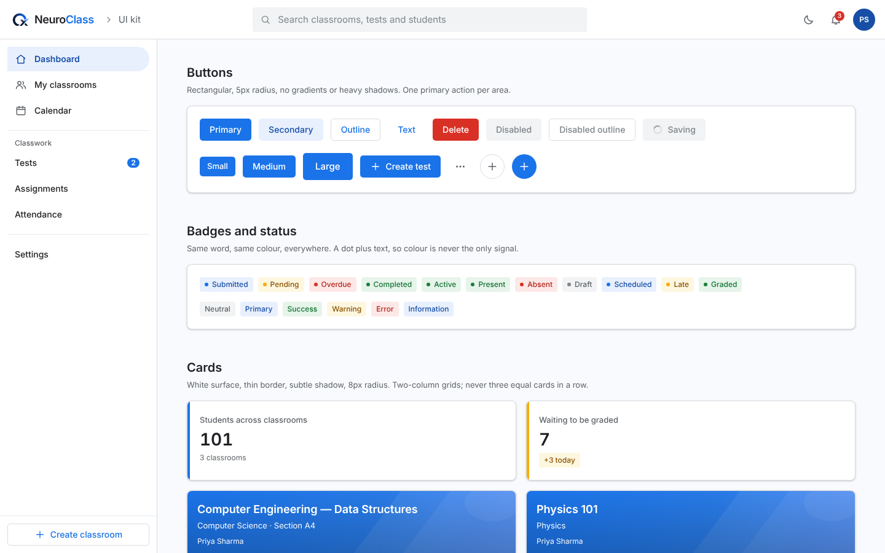

# NeuroClass design system

A bright, friendly, classroom-first interface: Google Classroom's clarity, a professional SaaS finish, and a NeuroClass identity of its own. One set of tokens, one component library, light and dark.

- **Tokens:** `frontend/index.css` (`:root` / `.dark` raw values → Tailwind `@theme`)
- **Components:** `frontend/components/ui/` (import from `components/ui`)
- **Live reference:** `/ui-kit` in the running app (every component and state, both themes)
- **Rules for use:** [COMPONENT_GUIDELINES.md](COMPONENT_GUIDELINES.md)

## Principles

1. **Clear before clever.** Every screen says what it is and what to do next. Labels are visible text; icons only support them.
2. **One primary action per area.** Blue fills are for the main action; everything else is outline, text or secondary.
3. **Calm surfaces, purposeful colour.** White cards on a soft canvas. Brand blue marks interaction and selection; status colours mean status and nothing else.
4. **Structured, not sparse.** Cards, sections and two-column grids give pages shape. No oversized empty areas, no three equal cards in a row.
5. **Accessible by default.** AA contrast, keyboard paths, focus rings and screen-reader names are built into the components, not added per page.

## Colour

Raw values live in `--nc-*` CSS variables that switch with the `.dark` class (set by `ThemeContext`). Use the Tailwind names, never hex values.

### Brand

| Token (Tailwind) | Light | Dark | Use |
|---|---|---|---|
| `primary` | `#1A73E8` | `#8AB4F8` | Primary buttons, links, active tab, focus ring |
| `primary-hover` | `#1558C0` | `#AECBFA` | Hover state of primary fills |
| `primary-light` | `#E8F0FE` | blue 14% | Selected nav item, secondary buttons, hover wash |
| `primary-soft` | `#D2E3FC` | blue 24% | Secondary surfaces, hover on `primary-light` |
| `primary-dark` | `#174EA6` | `#D2E3FC` | **Text on `primary-light`**, strong emphasis |
| `on-primary` | `#FFFFFF` | `#062E6F` | Text and icons on a `primary` fill |
| `bg-brand-gradient` | `#1A73E8 → #287AE6 → #4285F4` (110°) | deeper blue | Classroom covers and a few highlight areas only |

### Neutral

| Token | Light | Dark | Use |
|---|---|---|---|
| `canvas` | `#F8FAFD` | `#121314` | App background |
| `surface` | `#FFFFFF` | `#1E1F22` | Cards, panels, dialogs, top bar, sidebar |
| `surface-2` | `#F1F3F4` | `#2A2B2E` | Subtle fills: hover rows, disabled controls, chips |
| `ink` | `#202124` | `#E8EAED` | Headings and primary text |
| `ink-2` | `#5F6368` | `#BDC1C6` | Supporting text, metadata, labels |
| `ink-3` | `#80868B` | `#9AA0A6` | **Placeholders and disabled text only** (3.7:1 in light) |
| `line` | `#DADCE0` | `#3C4043` | Borders and dividers |
| `line-2` | `#E8EAED` | `#303134` | Hairlines inside cards |

### Status

Each status has three tokens: a fill (`success`), a readable text colour (`success-ink`) and a background (`success-bg`). Use `-ink` for text on `-bg`.

| Status | Fill | Text | Background |
|---|---|---|---|
| Success | `#188038` | `#137333` | `#E6F4EA` |
| Warning | `#F9AB00` | `#8A5300` | `#FEF7E0` |
| Error (`danger`) | `#D93025` | `#B3261E` | `#FCE8E6` |
| Information | `#1A73E8` | `#174EA6` | `#E8F0FE` |

Warning yellow is never used for text (it fails contrast); its `-ink` shade is.

### Contrast (WCAG 2.2 AA, verified)

All text pairings used by the components are ≥ 4.5:1 in both themes (body text 15.4:1; `ink-2` 6.0:1; white on `primary` 4.5:1; every badge 5.2–6.9:1). Known limits and the rules that handle them:

- `ink-3` (3.7:1): placeholders and disabled states only.
- `primary` on `primary-light` (3.9:1): not used for text; active nav and secondary buttons use `primary-dark` (6.9:1).
- The lighter end of the brand gradient (3.6:1 with white): banners carry a subtle bottom shade, and small text sits on the darker side; titles are large.

## Typography

**Inter** (self-hosted variable font, `@fontsource-variable/inter`), falling back to Roboto, system UI and Arial. Sentence case everywhere. No uppercase micro-labels, no wide letter-spacing, no weights below 400.

| Utility | Size / line height | Weight | Use |
|---|---|---|---|
| `text-page` | 28 / 36 px | 650 | One per page (`<h1>`) |
| `text-section` | 20 / 28 px | 600 | Section headings, dialog titles |
| `text-card` | 16 / 24 px | 600 | Card titles |
| `text-body` | 15 / 24 px | 400 | Default reading text, inputs |
| `text-support` | 13 / 20 px | 400 | Supporting copy, labels, hints |
| `text-meta` | 12 / 16 px | 400–500 | Metadata, badges, timestamps |
| `text-button` | 14 / 20 px | 500 | Buttons, tabs, nav |

Numbers that change or compare (scores, counts) use `tabular-nums`.

## Shape and space

| Token | Value | Use |
|---|---|---|
| `rounded-control` | 4 px | Inputs, badges, small controls |
| `rounded-button` | 5 px | Buttons |
| `rounded-card` | 8 px | Cards, panels, menus |
| `rounded-dialog` | 8 px | Dialogs |
| `rounded-full` | — | Avatars, icon buttons, switches only |

Spacing uses Tailwind's 4 px scale. Common rhythm: 4 / 8 / 12 / 16 / 24 / 32 / 48. Card padding is 20 px (`md`; 16 `sm`, 24 `lg`). Gaps between cards are 16 px; between page sections, 48 px. Page content is centred to a max width of 1152 px with 16, 24 or 32 px side padding by breakpoint.

Control heights: buttons 32 / 36 / 44 px (sm / md / lg); inputs 40 px; icon buttons 32 / 40 px; tabs and nav items 44 / 40 px. Touch targets are at least 32 px, and the main controls 40 px or more.

## Elevation and effects

| Token | Use |
|---|---|
| `shadow-card` | Resting cards (1 px, very soft) |
| `shadow-raised` | Hovered interactive cards, menus, toasts |
| `shadow-dialog` | Dialogs and the mobile drawer |

Not part of the system: glassmorphism, blur, glows, neon, purple-and-black branding, full-page gradients, gradient buttons.

## Motion

Short and functional: colour, shadow and transform transitions of 120–180 ms (`--duration-fast`, `--duration-base`) with `--ease-standard`. No entrance animations on lists or cards. `prefers-reduced-motion: reduce` disables transitions and animations app-wide (global rule in `index.css`).

## Iconography

`components/ui/icons.tsx`: a small in-house set of geometric line icons (24 px grid, 1.75 stroke, round caps), `aria-hidden` by default. Icons support labels, never replace them; icon-only buttons require a `label`. **No Lucide icons in the design system.** (Legacy screens still use Lucide and are migrated during the page redesign.) No sparkles or decorative AI symbols.

## Layout

- **App shell:** 64 px top bar (brand, search, notifications, account menu); fixed 256 px labelled sidebar from 1024 px; a drawer below that. Skip-to-content link first.
- **Grids:** two columns (`sm:grid-cols-2`) or full width. One-column lists for activity feeds and details. Never three equal statistic or content cards in a row.
- **Responsive:** no horizontal page scroll at any width (verified at 390 px). Tables become stacked lists below 640 px. Dialogs become bottom sheets on phones. Nothing is hidden behind fixed bottom bars.

## Light and dark

Every token has a dark value; components never use `dark:` overrides for colour, so new screens get dark mode for free by using tokens. The theme toggle (`ThemeContext`) sets `.dark` on `<html>`.

## Files

| File | Contents |
|---|---|
| `frontend/index.css` | Tokens, `@theme`, `bg-brand-gradient`, `focus-ring`, reduced-motion rule, legacy shadow rules (opt-out with `[data-ui]`) |
| `frontend/lib/utils.ts` | `cn()`; tailwind-merge configured with the token names |
| `frontend/components/ui/*` | The component library (see guidelines) |
| `frontend/features/lms/ui.tsx` | Compatibility layer: the old API, rendered with the kit |
| `frontend/features/ui-kit/UIKitShowcase.tsx` | `/ui-kit` living style guide |
| `scripts/ui-audit/kit.mjs` | Automated checks: screenshots, overflow, keyboard behaviour |
