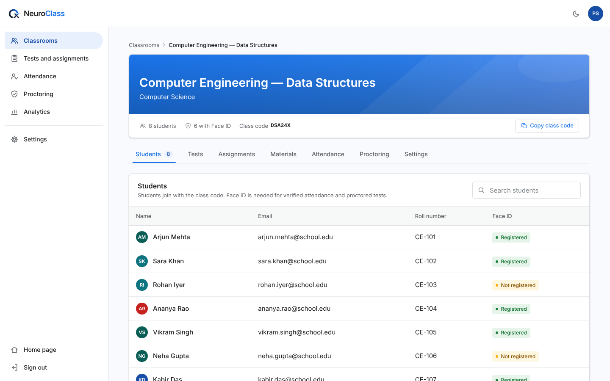

# UI implementation report

The NeuroClass UI kit ([DESIGN_SYSTEM.md](DESIGN_SYSTEM.md), [COMPONENT_GUIDELINES.md](COMPONENT_GUIDELINES.md)) applied across the web app. Before: [UI_UX_AUDIT.md](UI_UX_AUDIT.md) and `docs/ui-audit/before/`. After: `docs/ui-audit/after/`.

## What changed

### App frame and navigation
- Teacher and student portals share one frame (`features/shell/RoleShell.tsx`): a top bar with the brand, theme switch and account menu; a labelled sidebar from 1024 px; a drawer below that. This replaces the hover-to-expand icon rail, the bottom tab bar on phones and the purple student theme.
- Every section has its own URL, so Back, refresh and shared links work: `/teacher/classrooms/:id[/tests]`, `/teacher/attendance/:id`, `/teacher/reports`, `/student/classes`, `/student/history` and so on. Old ids (`dashboard`, `monitoring`) still resolve.
- Duplicate menu entries were removed: "Dashboard" and "Classrooms" opened the same list, as did "Live monitoring" and "Proctoring".

### Pages rebuilt with kit components
| Area | Page |
|---|---|
| Teacher | Classrooms (cards, search, actions menu, create dialog), classroom workspace (banner, tabs, student table), tests and assignments hub, attendance, proctoring, analytics, settings |
| Student | Home, classes, class workspace, tests, performance, history, project advisor, class assistant, settings |
| Public | Landing page, header, sign-in and sign-up dialog |
| Shared | Exam intro and exam shell colours, Drive panel, charts |

Every other screen (test editor, results, attempt review, coding workspace, join wizard, attendance modal, materials) was moved onto the kit tokens by a mechanical colour, type and radius migration. These screens keep their layouts, now in the kit's colours, type and radii.

### Fake data and dead controls removed
- **Teacher settings** showed an invented profile ("Dr. Sarah Jenkins") and AI, proctoring, payment and notification options that were saved only in the browser and read by nothing. The page now edits your real profile (`public.users`, name and mobile number), and theme. Test options are set per test, as before.
- **Analytics** showed hard-coded "weak topics", a "flagged submissions" count fixed at 0, and read a local store that nothing in the app writes to. It is now computed from your published tests and their results through the API: submissions, average of evaluated attempts, score distribution, lowest-scoring questions, and a tests table.
- **Student settings**: the "Exam release alerts" switch did nothing and was removed.
- **Student class page**: the empty "Announcements" tab had no backend and was removed.
- **Classes list**: the "classmates" count came from a stale legacy column and was removed.
- **Sign in**: the Student/Instructor tabs had no effect, because the role always comes from the server; they now appear only when creating an account.

### Visual rules now enforced
- No purple, glows, glass, blurred backdrops, uppercase micro-labels, or three equal cards in a row (all content grids are one or two columns).
- No Lucide icons. The dependency is removed; `icons-compat.tsx` draws the remaining icons in the kit style, and sparkle, brain and wand icons map to neutral ones.
- Charts use theme tokens (`CHART`), so they read correctly in dark mode.

### Removed files (verified unused)
`components/instructor/Sidebar.tsx`, `components/student/StudentSidebar.tsx`, and the old landing sections: `Hero`, `Features`, `WorkAndDashboard`, `TestAndFooter`, `ParticleBackground`.

## Verification
- `npm run lint` (TypeScript strict) and `vite build` pass.
- `scripts/ui-audit/pages.mjs` covers 21 pages × light/dark × desktop/mobile (84 screenshots):
  - no horizontal overflow;
  - no page errors;
  - the only console noise is from the sandbox: a mock websocket, a blocked model download, and analytics duplicate keys caused by mock data reusing test IDs across classrooms.
- `scripts/ui-audit/flows.mjs` covers sign-in, join class, exam intro, create classroom and the test editor, in both themes and on desktop and mobile. All render, with no overflow.
- `scripts/ui-audit/kit.mjs` still passes: keyboard, focus, dialog and drawer behaviour.

## Not changed
- No API, database or permission changes. Every request the pages make is the same as before or reads existing endpoints (`classrooms/:id/tests`, `tests/:id/results`, own `users` row).
- The AI evaluator screens (`TestPaperEvaluator`, `AssignmentEvaluator`, `AIModuleDashboard`) are not reachable from any route. They were left in place, migrated to tokens only.
- Inner layouts of the test editor, results and attempt review still use their earlier structure. They are good candidates for the next pass.
